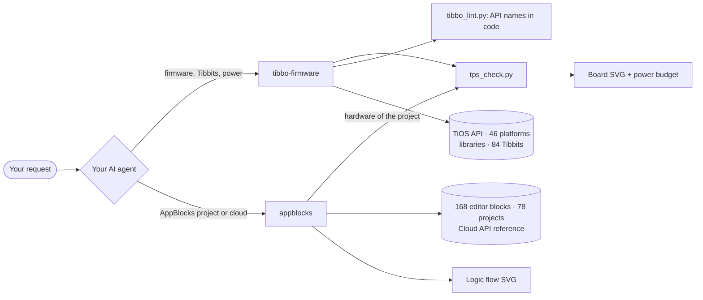

<div align="center">

# Tibbo Skills for AI agents

**Agent skills that turn your AI into a Tibbo firmware and AppBlocks engineer.**

Write and review Tibbo BASIC firmware, pick Tibbits and check TPS power budgets,
read, fix and generate AppBlocks projects - with real Tibbo API data instead of guesswork.

Claude · ChatGPT / Codex · Gemini · Kimi · DeepSeek · GLM

[](https://github.com/scancode-iot/tibbo-ai-skills/actions/workflows/tests.yml)
[](LICENSE)
[](#the-skills)
[](#requirements)
[](https://agentskills.io)

**English** · [Русский](README.ru.md)

</div>

---

## Why

Tibbo devices run TiOS - an event-driven OS with its own BASIC dialect, static memory, per-channel cursors
(`sock.num`, `ser.num`), and 60+ libraries that silently do nothing unless every callback and `*_proc_*` hook is wired.
Tibbit selection has its own traps: socket shapes, UART/interrupt lines, 9–18 V inputs on some power Tibbits, ±15 V rails.

General-purpose AI models know little of this and invent API names. These skills give the model the exact reference
data, working rules and offline checking tools, so its answers can be verified rather than trusted. They follow the open
[Agent Skills](https://agentskills.io) format, so the same folders work in Claude, Codex, Gemini CLI, Kimi Code,
Deep Code and other agents; a chat pack covers web chats.

> Tested by Tibbo Technology engineers in Taiwan.

## The skills

| Skill | What your AI can do with it |
|---|---|
| [**tibbo-firmware**](skills/tibbo-firmware/) | Write, review and debug Tibbo BASIC / Tibbo C firmware for TiOS (TPP2/TPP3, DS, EM, WM, WS devices); check every API name in the code (`tibbo_lint.py`); choose Tibbits for a task, lay them out in TPS sockets and check lines, UART/INT, connectors, PoE and the +5 V power budget; draw the board and firmware state machines. |
| [**appblocks**](skills/appblocks/) | Explain, review, edit and generate [AppBlocks](https://appblocks.io) projects (exported JSON); draw the logic flow; check the hardware through `tibbo-firmware`; compile the generated firmware with Tibbo's TIDE compiler; set up MQTT with your own broker; work with the AppBlocks Cloud API (projects, devices, OTA, workflows) with confirmation before any write. |

The two skills are designed to work together: AppBlocks hardware goes through the TPS checker of `tibbo-firmware`,
and firmware that AppBlocks generates for TiOS is reviewed with the `tibbo-firmware` checklist.



## What it looks like

<table>
<tr>
<td width="50%" valign="top">

**TPS board check** - sockets, Tibbits, `PL_IO_NUM_*` lines, `ser.num`, +5 V budget, drawn in the style of the Tibbo configurator.


</td>
<td width="50%" valign="top">

**Errors are numbered on the board** - wrong socket, 24 V into a 9–18 V supply, missing connector.


</td>
</tr>
<tr>
<td colspan="2">

**AppBlocks logic flow** - groups, nodes at their editor positions, coloured by role, port labels on links.


</td>
</tr>
<tr>
<td colspan="2">

**Firmware state machine** - states, outputs, transitions and fault paths taken from the code.


</td>
</tr>
</table>

> Diagram labels are in Russian, as in the original tooling. The AI answers in the language you write in.

## Works with

| Your AI | How | Runs the checks itself |
|---|---|---|
| **Claude** - apps, Claude Code, API | skills (zip upload, plugin, folder) | yes |
| **ChatGPT / Codex** - Codex CLI, Codex IDE extension | skills folder `~/.agents/skills` | yes |
| **Gemini** - Gemini CLI | skills folder | yes |
| **Kimi** - Kimi Code | skills folder | yes |
| **Kimi app (K3, K3.1 Pro)** - desktop and kimi.com, Agent mode | skill from Word documents: [Kimi set](docs/kimi/tibbo-skills-kimi-app.zip) | gives you the commands |
| **DeepSeek** - Deep Code, OpenCode, Claude Code | skills folder | yes |
| **GLM (Z.ai)** - Z Code, Claude Code, OpenCode, Codex | skills folder of the agent | yes |
| **Web chats** - ChatGPT, Gemini, Kimi, DeepSeek, GLM | chat pack | ChatGPT with code interpreter: yes; others give you the commands |

The quality still depends on the model: smaller models skip steps more often, so let the scripts check their work.

## Installation

Download from the [latest release](https://github.com/SCANCODE-IOT/tibbo-ai-skills/releases/latest).
Install **both** skills - `appblocks` uses the board checker from `tibbo-firmware`.
**Step-by-step guide for every AI: [docs/INSTALL.md](docs/INSTALL.md).**

| You use | Quick start |
|---|---|
| Claude apps | Customize → Skills → + → Upload a skill: `tibbo-firmware.zip`, then `appblocks.zip` |
| Claude Code | `/plugin marketplace add SCANCODE-IOT/tibbo-ai-skills`, then `/plugin install tibbo-skills@scancode` |
| Codex, Gemini CLI, Kimi Code, Deep Code and other agents | unpack *Source code (zip)* and run `python tools/install.py` |
| Kimi app (K3, K3.1 Pro) | [tibbo-skills-kimi-app.zip](docs/kimi/tibbo-skills-kimi-app.zip): Agent mode → Skills → "Convert Office Documents into a Skill" ([guide](docs/kimi/tibbo-skills-kimi-guide.ru.docx), Word, RU) |
| ChatGPT, Gemini, Kimi, DeepSeek, GLM in the browser | `tibbo-chat-pack.zip`: instructions + knowledge files + scripts |

The installer puts both skills into `~/.agents/skills/` (read by Codex, Gemini CLI, Kimi Code, Deep Code, Cline, Zed)
and into `~/.claude/skills/` if Claude Code is installed, then runs a self-test. `--agent opencode|cursor|copilot|all`,
`--project <folder>` and `--uninstall` are also available.

### Updating

Tell your agent **"Update the Tibbo skills"** - it runs the updater that ships with the skill
(`skills/tibbo-firmware/scripts/skills_update.py`, `--check` shows the installed and the latest version).
Or run `python tools/install.py --update` from the unpacked repository: it updates every agent where the skills are
installed. Claude Code plugin: `/plugin marketplace update scancode`, then `/plugin update tibbo-skills@scancode`.
Claude apps, the Kimi app and web chats: replace the files with the new ones.
**Every platform step by step: [docs/INSTALL.md → Updating](docs/INSTALL.md#updating).**
To get notified about new versions: **Watch → Custom → Releases** on this page.

## Usage examples

Just describe the task - the agent picks the skill by itself.

```text
I need a TPP3 controller that reads 4 Modbus RTU meters over RS485 and publishes
to MQTT over Wi-Fi. Powered from 24 V in the cabinet, up to 50 °C. Pick the Tibbits
and check the power.
```

```text
Review this Tibbo BASIC project for TPP2W(G3): main.tbs, device.tbs, global.tbh (attached).
Focus on socket handling and DHCP.
```

```text
Here is my AppBlocks export (attached). Explain what the device does,
draw the logic and the board, and list the problems.
```

```text
Add a "pump runtime" variable to this AppBlocks project and reset it every day at midnight.
```

Good habits that make answers better:

- **Name the platform exactly** - `TPP3W(G2)`, `TPP2W(G3)`, `DS1102W`, `EM2000W`.
- **Say which Tibbits sit in which sockets** and **what feeds the power** (12/24/48 V through which Tibbit, PoE).
- For library code, mention `src_lib_ver` from your `.tpr`.

The AI cannot run TIDE: it checks code statically against the reference data (and, for AppBlocks projects, can compile
them with Tibbo's build service) and says what was and was not verified. Always build and test on real hardware.

## Repository layout

```text
tibbo-ai-skills/
├── skills/
│   ├── tibbo-firmware/        # SKILL.md, references/, data/, scripts/, tests/
│   └── appblocks/             # SKILL.md, references/, scripts/, examples/, tests/
├── chat-pack/                 # PROMPT.md and README for web chats (knowledge files are built from the skills)
├── .claude-plugin/
│   └── marketplace.json       # Claude Code plugin catalog
├── docs/                      # INSTALL.md / INSTALL.ru.md, images generated by the skills' own scripts
├── tools/install.py           # installs both skills into Codex, Gemini CLI, Kimi Code, Claude Code and others
├── tools/package.sh           # builds dist/*.zip: two skills + tibbo-chat-pack.zip (tools/build_chat_pack.py)
└── .github/workflows/         # tests on every push, release packages on tags
```

## Requirements

The bundled scripts need **Python 3.9+ and nothing else** - only the standard library
(optional: `truststore` or `certifi` for `ab_api.py` on Windows, see [docs/INSTALL.md](docs/INSTALL.md#troubleshooting)).
The agent runs them by itself; you can also run them yourself:

```bash
cd skills/tibbo-firmware
python3 scripts/tps_check.py find "rs485 modbus"
python3 scripts/tps_check.py check tests/gallery_tpp3.json --svg board.svg
python3 scripts/tibbo_lint.py tests/lint/bad.tbs --platform "TPP3W(G2)"
```

The AppBlocks Cloud API client reads the key only from the `APPBLOCKS_API_KEY` environment variable.
If your agent runs in a cloud sandbox with a list of allowed sites (for example claude.ai, **Settings → Capabilities**),
add `api.appblocks.io` and `appblocks.io` to it first.

## Tests

```bash
sh skills/tibbo-firmware/tests/run.sh
sh skills/appblocks/tests/run.sh
```

Both suites run offline and on every push, together with the installer, the Agent Skills validator and the chat pack
limits (see [Actions](https://github.com/scancode-iot/tibbo-ai-skills/actions)).

## Data sources

The reference files were compiled in October 2026 from:

- [github.com/tibbotech](https://github.com/tibbotech) - TiOS API, platforms, libraries, Tibbit catalog, examples (extracted automatically, names and signatures are exact);
- [docs.tibbo.com](https://docs.tibbo.com) - power supply, sockets and tiles, PoE (written up by hand);
- [appblocks.io](https://appblocks.io) - example projects and the editor's node catalog.

Tibbo releases new libraries and Tibbits from time to time. If something is out of date,
please [open an issue](https://github.com/scancode-iot/tibbo-ai-skills/issues).

## Contributing

Bug reports with a real project or a real editor error are the most valuable contribution.
See [CONTRIBUTING.md](CONTRIBUTING.md).

## License

Code and skill instructions: [MIT](LICENSE) © 2026 Scancode.
Reference data and example projects derived from Tibbo Technology materials remain the property of their owners -
see [NOTICE](NOTICE).

Tibbo, Tibbit, TiOS, TIDE and AppBlocks are trademarks of Tibbo Technology Inc. This project is not an official
Tibbo product. Claude is a product of Anthropic; ChatGPT and Codex - of OpenAI; Gemini - of Google; Kimi - of Moonshot AI;
DeepSeek - of DeepSeek; GLM and Z.ai - of Zhipu AI.

<div align="center">

Made by **[Scancode](https://github.com/scancode-iot)** - Tibbo Technology distributor in Russia and the CIS.

</div>
