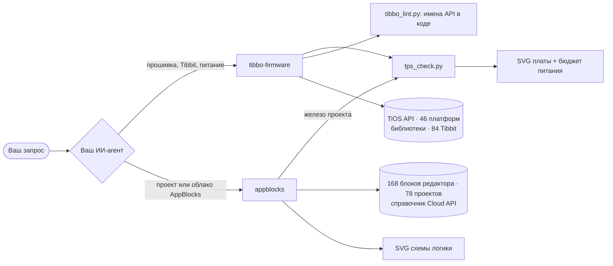

<div align="center">

# Скиллы Tibbo для ИИ-агентов

**Навыки, которые превращают вашу нейросеть в инженера по прошивкам Tibbo и проектам AppBlocks.**

Писать и проверять прошивки на Tibbo BASIC, подбирать Tibbit и считать бюджет питания TPS,
разбирать, исправлять и создавать проекты AppBlocks - на точных данных Tibbo API, а не по догадкам.

Claude · ChatGPT / Codex · Gemini · Kimi · DeepSeek · GLM

[](https://github.com/scancode-iot/tibbo-claude-skills/actions/workflows/tests.yml)
[](LICENSE)
[](#скиллы)
[](#требования)
[](https://agentskills.io)

[English](README.md) · **Русский**

</div>

---

## Зачем это нужно

Устройства Tibbo работают на TiOS - событийной ОС со своим диалектом BASIC, статической памятью, «курсорами» каналов
(`sock.num`, `ser.num`) и более чем 60 библиотеками, которые молча не работают, если не реализованы все колбэки
и не проброшены хуки `*_proc_*`. У подбора Tibbit свои ловушки: формы сокетов, линии UART и прерываний,
вход 9–18 В у части источников питания, шина ±15 В.

Универсальные модели знают об этом мало и выдумывают имена API. Скиллы дают модели точные справочные данные,
правила работы и офлайн-инструменты проверки, поэтому её ответы можно проверить, а не принимать на веру.
Скиллы сделаны в открытом формате [Agent Skills](https://agentskills.io): одни и те же папки работают в Claude,
Codex, Gemini CLI, Kimi Code, Deep Code и других агентах, а для веб-чатов есть чат-пакет.

> Скиллы протестированы инженерами Tibbo Technology на Тайване.

## Скиллы

| Скилл | Что умеет ваша нейросеть с ним |
|---|---|
| [**tibbo-firmware**](skills/tibbo-firmware/README.ru.md) | Писать, проверять и отлаживать прошивки на Tibbo BASIC / Tibbo C для TiOS (TPP2/TPP3, DS, EM, WM, WS); проверять каждое имя API в коде (`tibbo_lint.py`); подбирать Tibbit под задачу, раскладывать их по сокетам TPS и проверять линии, UART/INT, разъёмы, PoE и бюджет питания +5 В; рисовать плату и диаграммы состояний прошивки. |
| [**appblocks**](skills/appblocks/README.ru.md) | Объяснять, проверять, править и создавать проекты [AppBlocks](https://appblocks.io) (экспорт JSON); рисовать схему логики; проверять железо через `tibbo-firmware`; компилировать сгенерированную прошивку компилятором TIDE у Tibbo; настраивать MQTT со своим брокером; работать с AppBlocks Cloud API (проекты, устройства, OTA, workflow) с подтверждением перед любой записью. |

Скиллы работают в паре: железо проекта AppBlocks проверяется скриптом TPS из `tibbo-firmware`,
а прошивку, которую AppBlocks генерирует для TiOS, проверяют по чек-листу `tibbo-firmware`.



## Как это выглядит

<table>
<tr>
<td width="50%" valign="top">

**Проверка платы TPS** - сокеты, Tibbit, линии `PL_IO_NUM_*`, `ser.num`, бюджет +5 В в стиле конфигуратора Tibbo.


</td>
<td width="50%" valign="top">

**Ошибки пронумерованы прямо на плате** - неверный сокет, 24 В на источник 9–18 В, нет разъёма.


</td>
</tr>
<tr>
<td colspan="2">

**Схема логики AppBlocks** - группы, узлы на своих местах в редакторе, цвет по роли, подписи портов на связях.


</td>
</tr>
<tr>
<td colspan="2">

**Конечный автомат прошивки** - состояния, выходы, переходы и аварийные пути, взятые из кода.


</td>
</tr>
</table>

## С какими нейросетями работает

| Нейросеть | Как подключить | Сама запускает проверки |
|---|---|---|
| **Claude** - приложения, Claude Code, API | скиллы (загрузка zip, плагин, папка) | да |
| **ChatGPT / Codex** - Codex CLI, расширение Codex для IDE | папка скиллов `~/.agents/skills` | да |
| **Gemini** - Gemini CLI | папка скиллов | да |
| **Kimi** - Kimi Code | папка скиллов | да |
| **Приложение Kimi (K3, K3.1 Pro)** - на компьютере и kimi.com, режим Agent | скилл из документов Word: [комплект для Kimi](docs/kimi/tibbo-skills-kimi-app.zip) | даёт вам команды |
| **DeepSeek** - Deep Code, OpenCode, Claude Code | папка скиллов | да |
| **GLM (Z.ai)** - Z Code, Claude Code, OpenCode, Codex | папка скиллов агента | да |
| **Веб-чаты** - ChatGPT, Gemini, Kimi, DeepSeek, GLM | чат-пакет | ChatGPT с анализом данных - да; остальные дают вам команды |

Качество всё равно зависит от модели: небольшие модели чаще пропускают шаги, поэтому их работу проверяют скрипты.

## Установка

Скачайте файлы из [последнего релиза](https://github.com/SCANCODE-IOT/tibbo-claude-skills/releases/latest).
Ставьте **оба** скилла: `appblocks` проверяет плату скриптом из `tibbo-firmware`.
**Пошаговая инструкция для каждой нейросети: [docs/INSTALL.ru.md](docs/INSTALL.ru.md).**

| Чем пользуетесь | Быстрый старт |
|---|---|
| Приложения Claude | Customize → Skills → + → Upload a skill: `tibbo-firmware.zip`, затем `appblocks.zip` |
| Claude Code | `/plugin marketplace add SCANCODE-IOT/tibbo-claude-skills`, затем `/plugin install tibbo-skills@scancode` |
| Codex, Gemini CLI, Kimi Code, Deep Code и другие агенты | распакуйте *Source code (zip)* и запустите `python tools/install.py` |
| Приложение Kimi (K3, K3.1 Pro) | [tibbo-skills-kimi-app.zip](docs/kimi/tibbo-skills-kimi-app.zip): режим Agent → Skills → «Convert Office Documents into a Skill» ([инструкция в Word](docs/kimi/tibbo-skills-kimi-guide.ru.docx)) |
| ChatGPT, Gemini, Kimi, DeepSeek, GLM в браузере | `tibbo-chat-pack.zip`: инструкция + файлы знаний + скрипты |

Установщик кладёт оба скилла в `~/.agents/skills/` (её читают Codex, Gemini CLI, Kimi Code, Deep Code, Cline, Zed)
и в `~/.claude/skills/`, если стоит Claude Code, затем запускает самопроверку. Есть ключи
`--agent opencode|cursor|copilot|all`, `--project <папка>` и `--uninstall`.

## Примеры запросов

Просто опишите задачу - агент сам выберет скилл.

```text
Нужен контроллер на TPP3: опрашивает 4 счётчика по Modbus RTU через RS485 и отправляет
данные в MQTT по Wi-Fi. Питание 24 В в шкафу, до 50 °C. Подбери Tibbit и проверь питание.
```

```text
Проверь проект на Tibbo BASIC для TPP2W(G3): main.tbs, device.tbs, global.tbh (во вложении).
Особое внимание - работе с сокетами и DHCP.
```

```text
Вот экспорт проекта AppBlocks (во вложении). Объясни, что делает устройство,
нарисуй логику и плату, перечисли проблемы.
```

```text
Добавь в этот проект AppBlocks переменную «наработка насоса» и обнуляй её каждый день в полночь.
```

Что помогает получить точный ответ:

- **Точное имя платформы** - `TPP3W(G2)`, `TPP2W(G3)`, `DS1102W`, `EM2000W`.
- **Какие Tibbit в каких сокетах** и **от чего питание** (12/24/48 В через какой Tibbit, PoE).
- Для кода с библиотеками - `src_lib_ver` из `.tpr`.

Нейросеть не может запустить TIDE: она проверяет код статически по справочным данным (а проекты AppBlocks может
собрать сборщиком Tibbo) и честно пишет, что проверено, а что нет. Всегда собирайте и проверяйте прошивку на реальном устройстве.

## Структура репозитория

```text
tibbo-claude-skills/
├── skills/
│   ├── tibbo-firmware/        # SKILL.md, references/, data/, scripts/, tests/
│   └── appblocks/             # SKILL.md, references/, scripts/, examples/, tests/
├── chat-pack/                 # PROMPT.md и README для веб-чатов (файлы знаний собираются из скиллов)
├── .claude-plugin/
│   └── marketplace.json       # каталог плагинов Claude Code
├── docs/                      # INSTALL.md / INSTALL.ru.md, картинки (нарисованы скриптами самих скиллов)
├── tools/install.py           # ставит оба скилла в Codex, Gemini CLI, Kimi Code, Claude Code и другие агенты
├── tools/package.sh           # собирает dist/*.zip: два скилла + tibbo-chat-pack.zip (tools/build_chat_pack.py)
└── .github/workflows/         # тесты при каждом коммите, пакеты релиза по тегам
```

## Требования

Скриптам нужен **только Python 3.9+** - используется лишь стандартная библиотека
(по желанию `truststore` или `certifi` для `ab_api.py` на Windows, см. [docs/INSTALL.ru.md](docs/INSTALL.ru.md#если-что-то-не-так)).
Агент запускает их сам, но их можно запускать и самостоятельно:

```bash
cd skills/tibbo-firmware
python3 scripts/tps_check.py find "rs485 modbus"
python3 scripts/tps_check.py check tests/gallery_tpp3.json --svg board.svg
python3 scripts/tibbo_lint.py tests/lint/bad.tbs --platform "TPP3W(G2)"
```

Клиент AppBlocks Cloud API берёт ключ только из переменной окружения `APPBLOCKS_API_KEY`.
Если агент работает в облачной песочнице со списком разрешённых сайтов (например, claude.ai, **Settings → Capabilities**),
сначала добавьте туда `api.appblocks.io` и `appblocks.io`.

## Тесты

```bash
sh skills/tibbo-firmware/tests/run.sh
sh skills/appblocks/tests/run.sh
```

Оба набора работают без сети и запускаются при каждом коммите вместе с проверкой установщика, валидатором
Agent Skills и лимитами чат-пакета (см. [Actions](https://github.com/scancode-iot/tibbo-claude-skills/actions)).

## Источники данных

Справочники собраны в октябре 2026 года из:

- [github.com/tibbotech](https://github.com/tibbotech) - API TiOS, платформы, библиотеки, каталог Tibbit, примеры (извлечены автоматически, имена и сигнатуры точные);
- [docs.tibbo.com](https://docs.tibbo.com) - питание, сокеты и тайлы, PoE (выписаны вручную);
- [appblocks.io](https://appblocks.io) - проекты-примеры и каталог узлов редактора.

Tibbo периодически выпускает новые библиотеки и Tibbit. Если что-то устарело,
[создайте issue](https://github.com/scancode-iot/tibbo-claude-skills/issues).

## Участие

Самое ценное - сообщения об ошибках с реальным проектом или реальной ошибкой редактора.
См. [CONTRIBUTING.md](CONTRIBUTING.md).

## Лицензия

Код и инструкции скиллов: [MIT](LICENSE) © 2026 Scancode.
Справочные данные и проекты-примеры, полученные из материалов Tibbo Technology, остаются собственностью
правообладателей - см. [NOTICE](NOTICE).

Tibbo, Tibbit, TiOS, TIDE и AppBlocks - товарные знаки Tibbo Technology Inc. Проект не является официальным
продуктом Tibbo. Claude - продукт Anthropic; ChatGPT и Codex - OpenAI; Gemini - Google; Kimi - Moonshot AI;
DeepSeek - DeepSeek; GLM и Z.ai - Zhipu AI.

<div align="center">

Сделано **[Сканкод (Scancode)](https://github.com/scancode-iot)** - дистрибьютором Tibbo Technology в России и СНГ.

</div>
