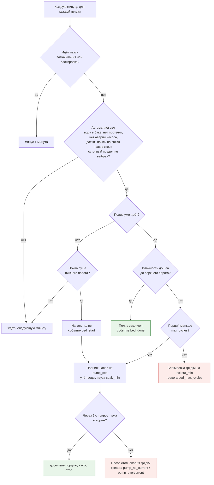

# TOTAL SMART SCHOOL GREENHOUSE 2: инструкция

Умная школьная теплица на Tibbo TPP3W(G2): автоматический полив двух грядок, вентиляция, досветка, защита бака и учёт воды. Проект - `greenhouse2_tpp3.json`, логгер для компьютера - `greenhouse2_logger.py`. Прошивка 5.0.0, Сканкод, 2 ноября 2026.

## 1. Что умеет теплица

Контроллер сам поливает две грядки по датчикам влажности почвы, включает вентилятор по температуре и досвечивает растения, когда мало света. Автоматика работает без компьютера и без интернета: компьютер нужен только для журнала, графиков и удалённых команд.

- **Полив «цикл и замачивание».** Короткая порция воды, пауза 15 минут, чтобы вода впиталась, затем решение по датчику. Полив заканчивается, когда почва дошла до верхнего порога.

- **Защиты.** Сухой ход насоса (поплавок), протечка, лимит порций, суточный предел воды, потеря связи с датчиками, контроль тока насоса.

- **Учёт.** Расчётный расход воды по грядкам за сутки, ток и энергия нагрузок.

- **Управление.** Веб-панель устройства с кнопками и показаниями, команды по MQTT, журнал и графики на компьютере.

Комплект проекта: проект в облаке AppBlocks, файл TOTAL_SMART_SCHOOL_GREENHOUSE_2.json для импорта, логгер greenhouse2_logger.py, схема логики greenhouse2_logic.pdf, схема платы greenhouse2_board.png.

## 2. Оборудование и подключение

Плата TPP3W(G2) в корпусе TPB3, питание от адаптера 230/12 В не менее 8 А. Раскладка проверена в редакторе AppBlocks: 0 ошибок, 0 предупреждений; шина +5 В загружена на 67 % (740 мА из 1 100 мА).

| **Сокет**              | **Tibbit**                         | **Что подключаем**                                                                                                                              |
|------------------------|------------------------------------|-------------------------------------------------------------------------------------------------------------------------------------------------|
| S1 (+ \#20 в S2)       | \#05, RS-485                       | Шина Modbus RTU 9600 8N1: датчики почвы (адреса 1, 2), освещённости (3, 4), температуры и влажности воздуха (5)                                 |
| S3 (+ \#20 в S2)       | \#54, четыре входа «сухой контакт» | IN1 - поплавок «бак пуст»; IN2 - датчик двери (резерв); IN3 - поплавок «мало воды»; IN4 - датчик протечки. Общий провод - клемма 5 разъёма \#20 |
| S5-S8                  | \#61-2, изолированный АЦП          | Датчик тока на эффекте Холла, вход VIN1 (0-10 В). Изолированную землю \#61 не соединять с землёй платы                                          |
| S17 (+ \#20 в S18)     | \#17, три ШИМ-выхода до 4 А        | Лампа 1, лампа 2, вентилятор                                                                                                                    |
| S21+S23 (+ \#20 в S22) | \#06, два реле 16 А                | Насос грядки 1 и насос грядки 2, 12 В                                                                                                           |
| S25 + S26              | \#10 + \#18                        | Питание платы от 12 В. Не подавайте питание одновременно на джек и на клеммы \#18                                                               |
| \-                     | WA2000C                            | Wi-Fi и Bluetooth                                                                                                                               |

Карта регистров в проекте типовая для распространённых RS-485 датчиков: влажность почвы - регистр 0 с шагом 0,1 %, освещённость - регистры 2-3 (32 бита, лк), воздух - входные регистры 1 (температура, 0,1 °C) и 2 (влажность, 0,1 %). До запуска сверьте её с паспортом своих датчиков и при необходимости поправьте в AppBlocks: Features → Modbus Master.

Картинка платы с бюджетом питания: `python3 scripts/ab_tool.py tps examples/greenhouse2_tpp3.json --vin 12 --out cfg.json`, затем `python3 ../tibbo-firmware/scripts/tps_check.py check cfg.json --svg board.svg`.

## 3. Перед первым запуском

Пройдите список по порядку: сначала без воды и растений, потом с водой. На стенд уходит около часа, плюс 3-5 дней наблюдения для подбора порогов.

### Прошивка и сеть

- Откройте проект в AppBlocks и убедитесь, что в строке состояния внизу 0 ошибок и 0 предупреждений. Загрузите прошивку в контроллер в режиме Release. Не оставляйте устройство в режиме Debug: без связи с редактором оно останавливается.

- Подключитесь к контроллеру по Wi-Fi или Ethernet и откройте веб-консоль по его IP-адресу.

- **Первым делом задайте пароль веб-консоли**: настройка «Пароль веб-консоли (пользователь admin)» (WBPWD), затем перезагрузка. До этого консоль открыта любому в той же сети. Пароль не пишется в файл проекта и не уходит в облако.

- Задайте сеть Wi-Fi, IP компьютера с брокером (MQTTHOST) и сервер времени (NTPHOST). В сети без интернета укажите локальный NTP-сервер (на роутере или компьютере).

- Дайте компьютеру с брокером постоянный IP (резервирование в DHCP роутера), иначе после смены адреса телеметрия пропадёт.

### Без воды

- В веб-панели или логгере (status) все шесть датчиков дают правдоподобные значения, датчики почвы «на связи».

- Разомкните поплавок «пусто»: насосы стоят, через 5 с звучит сигнал и приходит тревога no_water.

- Замкните датчик протечки: тревога leak, автоматика выключилась. Разомкните и включите автоматику переключателем в панели.

- Отключите один датчик почвы от шины: через несколько секунд тревога soil1_offline, полив этой грядки не начинается.

### С водой

- Если датчика тока на стенде нет, поставьте pump_i_min = 0, иначе каждая порция даст аварию pump1_no_current.

- С датчиком тока: дайте порцию кнопкой «Полить грядку 1» и посмотрите, насколько вырастает «Ток нагрузки». Задайте pump_i_min около 70 % этого прироста, pump_i_max - в 1,5-2 раза больше.

- Откалибруйте производительность насоса flow_ml_s (раздел 8).

- Проверьте, что после остановки насоса вода не течёт самотёком (сифон, раздел 8).

- Сухой субстрат: в журнале bed1_start, порции раз в 15 минут, bed1_done.

- Сутки работы без вмешательства: сброс счётчиков в полночь (day_reset), досветка с 7:00 до 21:00 по реальному времени, нет тревоги time_not_synced.

- За 3-5 дней по графикам логгера подберите пороги влажности, длину порции и паузу.

## 4. Настройки

Настройки меняются в веб-консоли (раздел «Теплица: настройки») или через Bluetooth и хранятся в памяти контроллера. Перепрошивать не нужно. Адреса брокера и сервера времени, пароль консоли применяются после перезагрузки.

| **Настройка**               | **По умолч.**   | **Диапазон** | **Что задаёт и как подобрать**                                              |
|-----------------------------|-----------------|--------------|-----------------------------------------------------------------------------|
| soil1_min / soil2_min       | 35 %            | 0-100        | Начать полив, если почва суше. Подбирается по графикам под грунт и культуру |
| soil1_target / soil2_target | 45 %            | 0-100        | Закончить полив. Держите на 8-15 % выше нижнего порога                      |
| pump_sec                    | 8 с             | 3-25         | Длина одной порции. Вода в поддоне после порции - уменьшить                 |
| soak_min                    | 15 мин          | 2-120        | Пауза на впитывание. Влажность после порции растёт медленно - увеличить     |
| max_cycles                  | 4               | 1-20         | Сколько порций можно дать за один полив                                     |
| lockout_min                 | 180 мин         | 10-1440      | Пауза грядки после того, как лимит порций выбран, а почва всё ещё сухая     |
| flow_ml_s                   | 20 мл/с         | 1-500        | Производительность насоса для учёта воды. Только по калибровке              |
| water_day_ml                | 1500 мл         | 0-20000      | Предел воды на грядку в сутки - последняя защита от перелива                |
| pump_i_min                  | 0,3 А           | 0-10         | Минимальный прирост тока при включении насоса. 0 - проверка выключена       |
| pump_i_max                  | 5 А             | 0-20         | Максимальный прирост тока (заклинивание). 0 - не проверять                  |
| fan_on_t / fan_off_t        | 28 / 25 °C      | 10-45        | Вентилятор включается выше и выключается ниже                               |
| light_min_lx                | 3000 лк         | 0-100000     | Досветка включается, если естественного света меньше                        |
| lamp_pwr                    | 80 %            | 0-100        | Яркость ламп досветки                                                       |
| i_zero_v / i_sens           | 0,5 В / 0,4 В/А | \-           | Паспортные данные датчика Холла: выход при нулевом токе и чувствительность  |
| bus_v                       | 12 В            | 5-30         | Напряжение нагрузок для расчёта мощности (не измеряется)                    |
| MQTTHOST                    | 192.168.1.100   | IP           | Компьютер с брокером MQTT                                                   |
| NTPHOST                     | 216.239.35.0    | IP           | Сервер времени (time.google.com). Без интернета - локальный NTP             |
| WBPWD                       | пусто           | до 32 симв.  | Пароль веб-консоли для пользователя admin                                   |

В разделе «Теплица: состояние» видны служебные значения, которые меняет сама автоматика: автоматика вкл/выкл, аварии насосов и вода за сутки. Они тоже хранятся в памяти и переживают перезагрузку. Расписание досветки (7:00-21:00) и сброса счётчиков (0:00) меняется в AppBlocks: Features → Scheduler.

## 5. Как работает полив

Если включить насос надолго, вода не успевает впитаться: стекает по краям, уходит в поддон, а датчик в корнях долго показывает «сухо». Поэтому полив идёт короткими порциями с паузой, а решение о следующей порции принимается после того, как вода впиталась.

Решение о поливе, раз в минуту для каждой грядки:

### Пример с настройками по умолчанию

Порция 8 с × 20 мл/с = 160 мл. Допустим, каждая порция после замачивания поднимает влажность на 3 %.

| **Минута** | **Влажность** | **Что происходит**                                  | **Вода за сутки** |
|------------|---------------|-----------------------------------------------------|-------------------|
| 0          | 33 %          | Полив начат (bed1_start), порция 1                  | 160 мл            |
| 15         | 36 %          | Выше 35 %, но ниже 45 % - порция 2                  | 320 мл            |
| 30         | 39 %          | Порция 3                                            | 480 мл            |
| 45         | 42 %          | Порция 4                                            | 640 мл            |
| 60         | 45 %          | Верхний порог достигнут, полив закончен (bed1_done) | 640 мл            |

### Что ещё важно знать

- Обе грядки проверяются в одну и ту же минуту, но насос грядки 2 включается через 30 с после грядки 1: пусковые токи не складываются, замер тока каждого насоса не сбивается другим.

- Если датчик залип или вынут из земли, грядка получает не больше 4 порций, затем блокируется на 3 часа с тревогой bed1_max_cycles. Суточный предел ограничивает воду до 1,6 л за сутки.

- При обрыве связи с датчиком почвы (3 неответа подряд) полив грядки стоит до восстановления связи.

- Вентилятор переключается раз в минуту, через 45 с после такта полива; замер света для досветки - каждые 10 минут, через 40 с после такта. Так лампы и вентилятор не меняют ток во время замера тока насосов.

## 6. Управление: веб-панель и команды

Веб-панель открывается по IP-адресу контроллера, вкладка Dashboard. На ней карточки показаний, переключатель «Автоматика» и четыре кнопки. Те же команды можно отправить текстом в MQTT-топик greenhouse/cmd или логгером с компьютера.

| **Команда**     | **В панели**               | **Что делает**                                                                                                                        |
|-----------------|----------------------------|---------------------------------------------------------------------------------------------------------------------------------------|
| water1 / water2 | кнопка «Полить грядку 1/2» | Одна порция pump_sec. Сработает, если в баке есть вода, нет протечки, насос не работает и суточный предел не выбран. Вода учитывается |
| stop            | кнопка «СТОП»              | Аварийная остановка: насосы стоп, полив прерван, **автоматика выключена**                                                             |
| auto_on         | переключатель «Автоматика» | Включить автоматику (не сработает при протечке)                                                                                       |
| unlock          | кнопка «Сброс аварий»      | Снять аварии насосов и блокировки грядок после лимита порций                                                                          |

Перед unlock устраните причину: если насос по-прежнему не крутится, авария вернётся на первой же порции. Ручной полив работает и при выключенной автоматике - это удобно для проверки линий, но суточный предел действует всегда.

## 7. Тревоги и события

Тревоги приходят в топик greenhouse/alarm, события - в greenhouse/event. Логгер выводит тревоги на экран и сохраняет всё в базу. При тревогах «нет воды», «протечка» и аварии насоса контроллер подаёт тройной звуковой сигнал.

| **Сообщение**                             | **Что случилось**                                                                  | **Что делать**                                                                                    |
|-------------------------------------------|------------------------------------------------------------------------------------|---------------------------------------------------------------------------------------------------|
| no_water                                  | Бак пуст или оборван провод поплавка. Насосы остановлены                           | Долить воду, проверить поплавок и провод. Полив продолжится сам                                   |
| tank_low                                  | Сработал поплавок «мало воды»                                                      | Долить воду в ближайшие сутки                                                                     |
| leak                                      | Сработал датчик протечки. Насосы стоп, автоматика выключена                        | Найти и устранить протечку, вытереть датчик, включить автоматику                                  |
| bed1_max_cycles                           | Дали все порции, а почва всё ещё сухая. Грядка заблокирована на lockout_min        | Проверить датчик почвы (место, контакт с грунтом), капельницы и насос                             |
| pump1_no_current                          | Насос включён, но ток почти не вырос: обрыв, насос не крутится или работает всухую | Проверить насос, провода, предохранитель, воду у заборника; затем unlock                          |
| pump1_overcurrent                         | Ток слишком большой: заклинивание, засор, КЗ                                       | Обесточить, проверить насос и линию; затем unlock                                                 |
| soil1_offline, soil2_offline, air_offline | Датчик не отвечает по Modbus 3 раза подряд                                         | Проверить питание, провода A/B, адрес датчика. После восстановления связи работа продолжится сама |
| time_not_synced                           | Часы контроллера не получили время                                                 | Проверить NTPHOST и доступ к серверу времени                                                      |
| online                                    | Контроллер подключился к брокеру                                                   | Ничего; частые online - нестабильная связь                                                        |
| bed1_start / bed1_done                    | Начало и конец полива грядки                                                       | \-                                                                                                |
| day_reset / day_reset_uptime              | Сброс суточных счётчиков в полночь / через 24 ч работы без времени                 | \-                                                                                                |
| stopped, unlocked, auto_on                | Выполнены команды                                                                  | \-                                                                                                |

## 8. Насосы

### Какой насос выбрать

- **Погружной центробежный 12 В** - тихий и недорогой, но должен всегда быть под водой и плохо держит напор на длинных или капельных линиях. Поплавок «пусто» - обязательно выше заборника.

- **Мембранный самовсасывающий 12 В** - сам поднимает воду из бака, даёт напор для капельниц, короткий сухой ход переносит лучше. Громче и требует фильтра на всасе. Для полива через капельницы обычно выбирают его.

- Производительность по паспорту указана без нагрузки. На трубке 1-2 м с капельницами реальная заметно ниже, поэтому только калибровка.

### Электрика

- **Пусковой ток** мотора в несколько раз больше рабочего. Реле \#06 рассчитаны на 16 А при 48 В на активной нагрузке; для мотора 12 В запас большой.

- **Диод на каждый мотор.** Параллельно насосу и вентилятору поставьте обратно включённый диод (лучше Шоттки, на ток не меньше тока мотора). Без него выброс напряжения при отключении жжёт контакты реле и наводит помехи на шину RS-485 и АЦП. У \#17 встроенные защитные диоды в документации не указаны.

- **Предохранитель на каждый насос**: заклинивший насос не должен ронять питание контроллера.

### Гидравлика

- **Сифон.** Если бак стоит выше выходов полива, после выключения насоса вода продолжает течь самотёком, и порция становится бесконечной. Ставьте бак ниже грядок или обратный клапан плюс антисифонное отверстие в верхней точке трубки.

- **Заполнение трубки.** Первые секунды порции уходят на заполнение пустой трубки. Обратный клапан держит её заполненной, и порции становятся одинаковыми.

- **Фильтр** на заборе и промывка капельниц: засор - главная причина «насос работает, а грядка сухая».

### Калибровка flow_ml_s

1.  Соберите линию полностью: бак, насос, трубка, капельницы - как в теплице.

2.  Дайте 5 порций командой «Полить грядку» в мерную ёмкость (между порциями пауза).

3.  flow_ml_s = объём / (5 × pump_sec). Пример: 600 мл за 5 порций по 8 с - 15 мл/с.

4.  Повторите для второй грядки. Если результаты отличаются больше чем на 10 %, выровняйте линии (длина, число капельниц).

## 9. Бак и вода

- **Объём.** Пределы проекта - до 3 л в сутки на две грядки. Бак 20 л - около недели при максимальном поливе; меньше 10 л - доливать почти каждый день.

- **Поплавок «пусто»** (IN1) ставится так, чтобы при срабатывании над заборником оставалось 3-5 см воды. Подключение отказобезопасное: контакт замкнут, пока вода есть; обрыв провода тоже даёт «нет воды».

- **Поплавок «мало воды»** (IN3) - на 1-2 суток расхода выше нижнего: тревога tank_low приходит заранее. Тоже замкнут, пока уровень выше.

- **Датчик протечки** (IN4) под баком и насосами: при срабатывании насосы стоп и автоматика выключается. Датчик должен замыкать контакт при появлении воды; если у вашего датчика выход наоборот (размыкается), используйте промежуточное реле.

- **Непрозрачный бак с крышкой**: нет водорослей, мусора, комаров и испарения. Вода комнатной температуры.

- С удобрениями промывайте бак и линии чистой водой раз в 2-4 недели: соли забивают капельницы и мембрану насоса.

## 10. Датчики и шина RS-485

- **Пороги 35 и 45 % - ориентир.** Шкала датчика зависит от грунта. Запишите показание в сухом субстрате, сразу после полного пролива и через сутки; пороги выберите между ними по графикам логгера.

- **Установка датчика почвы**: в зоне корней, на глубине 5-10 см и в 5-10 см от капельницы. Иначе он видит струю, а не грядку, и полив заканчивается раньше времени. Грунт вокруг датчика плотный, без воздушных карманов.

- **Шина**: витая пара, линия без ответвлений-«звёзд», терминаторы 120 Ом на двух концах, общий провод между датчиками и контроллером, уникальные адреса 1-5, скорость 9600, 8N1.

- **Датчик тока** измеряет общий ток нагрузок 12 В, в том числе ламп и вентилятора. Поэтому контроль насоса смотрит на прирост тока при включении, а не на абсолютное значение.

- Связь с датчиками освещённости не контролируется: если они пропадут, досветка будет работать по последнему значению.

## 11. Питание и электрика

- Адаптер 230/12 В не менее 8 А: два насоса с пусковым током, две лампы, вентилятор и сам контроллер. Загрузка адаптера в работе - не выше 80 %.

- Плата питается через \#10 (вход 9-18 В) и разъём \#18. Не подавайте питание одновременно на джек и на клеммы \#18.

- Входы \#54 не изолированы гальванически (опторазвязка от помех есть). Провода поплавков и датчика протечки не прокладывайте вместе с силовыми.

- Изолированный АЦП \#61: земля датчика Холла - на изолированной стороне, не соединяйте её с землёй платы.

- Корпус и вода: контроллер и адаптер - выше уровня бака и вдали от брызг, кабельные вводы снизу.

## 12. Ограничения и известные особенности

- **Блокировка после лимита порций сбрасывается при перезагрузке.** Суточный предел и аварии насосов при этом сохраняются, поэтому перелив ограничен 1,6 л в сутки даже при частых перезагрузках.

- **Ложная авария насоса в 21:00.** Если лампы выключатся по расписанию ровно в момент замера тока насоса, прирост тока может показаться меньше порога. Снимается командой unlock. Вероятность мала: замер длится 2 с.

- **Вода считается, а не измеряется.** Точность учёта равна точности калибровки flow_ml_s. Для точного учёта нужен импульсный расходомер.

- **Без синхронизации времени** досветка и полночный сброс идут не по реальным часам. Счётчики воды всё равно сбрасываются каждые 24 часа работы, а контроллер шлёт тревогу time_not_synced.

- **Публикации MQTT без связи теряются.** Контроллер не копит телеметрию; после восстановления связи приходит событие online, а пропуск виден на графиках.

- **Пароль консоли** применяется после перезагрузки. Роль «пользователь только для просмотра» на этой платформе (TiOS) не поддерживается: в консоль заходит только admin.

- **Блок «2. Полив: такт 60 с»** в AppBlocks связан с блоками других групп (полив, вентиляция, досветка). В редакторе группы показываются отдельными вкладками, поэтому связи между вкладками не видны на одном холсте.

## 13. Компьютер: брокер и логгер

1.  Установите брокер Mosquitto (mosquitto.org/download). В mosquitto.conf добавьте строки listener 1883 и allow_anonymous true (для учебного стенда в закрытой сети; для рабочей установки - пароли). Разрешите входящий порт 1883 в брандмауэре.

2.  Установите Python и библиотеки: pip install paho-mqtt matplotlib.

3.  Запустите python greenhouse2_logger.py log - логгер пишет данные в greenhouse2.db и печатает тревоги.

4.  python greenhouse2_logger.py status - состояние теплицы и последние тревоги; events 30 - журнал; plot 24 - графики за сутки в greenhouse2.png; water1, water2, stop, unlock, auto_on - команды.

Контроллер публикует телеметрию раз в 10 с пятью сообщениями greenhouse/tele/env, /power, /io, /bed1, /bed2: строка Tibbo BASIC вмещает не больше 255 символов вместе с топиком, поэтому одно большое сообщение обрезалось бы. Свой софт (Node-RED, Grafana) может подписаться на greenhouse/# и разбирать строки вида ключ=значение;ключ=значение.

## 14. Если что-то не работает

| **Признак**                                 | **Причина и что проверить**                                                                                                                        |
|---------------------------------------------|----------------------------------------------------------------------------------------------------------------------------------------------------|
| Нет данных в логгере                        | IP брокера (MQTTHOST), брандмауэр порта 1883, Mosquitto 2.x без строки listener 1883 слушает только localhost, гостевой Wi-Fi с изоляцией клиентов |
| Насос не включается, тревог нет             | Автоматика выключена, грядка в блокировке (cs_wait в status), суточный предел выбран, почва влажнее нижнего порога                                 |
| Каждая порция - pump_no_current             | Нет датчика тока или он не откалиброван: pump_i_min = 0 или подобрать по замеру; проверить i_zero_v и i_sens                                       |
| Влажность скачет после полива               | Датчик слишком близко к капельнице или в воздушном кармане                                                                                         |
| Вода течёт после остановки насоса           | Сифон: бак выше выходов, нужен обратный клапан                                                                                                     |
| Досветка не в те часы                       | Нет синхронизации времени: NTPHOST, доступ в интернет или локальный NTP                                                                            |
| Плата перезагружается при включении насосов | Просадка питания: адаптер слабее 8 А, нет диодов на моторах, общий провод насосов идёт через плату                                                 |
